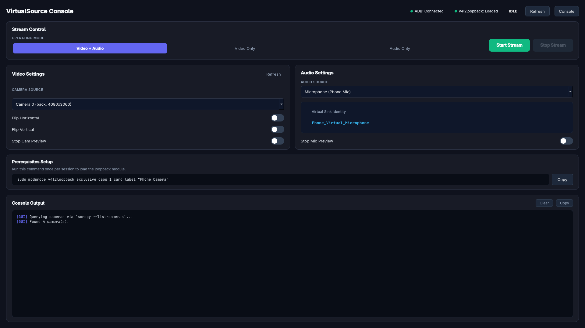

<div align="center">

# Virtual Source
[](https://python.org)
[](https://riverbankcomputing.com)
[](https://pipewire.org)
[](https://github.com/astral-sh/uv)
[](LICENSE)

**تطبيق واجهة برمجية عالي الأداء لتحويل هاتف الأندرويد إلى كاميرا وهمية وميكروفون نظام مدمج على Linux**  
*A high-performance Linux desktop app converting Android devices into native virtual webcams and microphones using scrcpy, v4l2loopback, and PipeWire.*

<br/>



<br/>

[**العربية**](#العربية) | [**English**](#english)

</div>

---

## العربية

### نبذة عن المشروع
تطبيق **Virtual Source** هو أداة واجهة سطح مكتب حديثة مبنية بـ **PyQt6** و **Python**، مخصصة لأنظمة **Linux (Arch Linux / PipeWire / PulseAudio)**. يقوم التطبيق بتحويل هاتف الأندرويد المرتبط عبر USB/ADB إلى:
1. **كاميرا وهمية عالية الجودة** يتم بثها مباشرة إلى المسار `/dev/video0`.
2. **ميكروفون وهمي على مستوى النظام** باسم `Phone_Virtual_Microphone` يتم التعرف عليه تلقائياً في كافة البرامج (مثل Discord و OBS و Google Meet و Telegram).

### المميزات الرئيسية
* **أنماط بث متعددة:**
  * **Video + Audio:** بث الكاميرا والميكروفون بالتزامن.
  * **Video Only:** بث الفيديو فقط إلى `/dev/video0`.
  * **Audio Only:** بث ميكروفون الهاتف أو الصوت الداخلي بذاكرة مؤقتة منخفضة جداً (`--audio-buffer=50`).
* **التعرف التلقائي على كاميرات الهاتف:** فحص المستشعرات الأمامية والخلفية بدقة عبر `scrcpy --list-cameras`.
* **خيارات التدوير والقلب اللحظي:** دعم القاطعات الأفقية والرأسية مع إعادة التشغيل اللحظي للبث.
* **إدارة متقدمة لبث الصوت عبر PipeWire / PulseAudio:** إنشاء `Phone_Audio_Sink` وتوجيهه كـ `Audio/Source` لتشغيل الميكروفون كجهاز حقيقي مع تنظيف تلقائي للموديولات العالقة.
* **مفاتيح تحكم ذكية بالمعاينة:** إيقاف نافذة المعاينة مع استمرار البث للنظام بالخلفية لترشيد الاستهلاك.

### المتطلبات الأساسية
1. **scrcpy** (الإصدار 4.1+):
   ```bash
   sudo pacman -S scrcpy   # Arch Linux
   ```
2. **v4l2loopback** (لتوفير كاميرا وهمية `/dev/video0`):
   ```bash
   sudo pacman -S v4l2loopback-dkms v4l2loopback-utils
   ```
3. **PipeWire / PulseAudio / pactl**: للتحكم في موديولات الصوت والميكروفون الوهمي.
4. تفعيل وضع المطور وتصحيح أخطاء USB (USB Debugging) على هاتف الأندرويد.

### طريقة التشغيل
1. **تحميل موديول الكاميرا الوهمية (مرة واحدة عند تشغيل الجهاز):**
   ```bash
   sudo modprobe v4l2loopback exclusive_caps=1 card_label="Phone Camera"
   ```
2. **تشغيل التطبيق عبر `uv`:**
   ```bash
   uv run python android_virtual_cam_mic.py
   ```

### بنية الصوت المتقدمة
* يتم إنشاء **Null Sink** باسم `Phone_Audio_Sink` مع تحديد خاصية `media.class="Audio/Sink"`.
* يتم إعادة توجيهه عبر `module-remap-source` باسم `Phone_Virtual_Microphone` مع تحديد `media.class="Audio/Source"` و `device.class="sound"`.
* تضمن هذه الخواص التعرف الفوري على الميكروفون في متصفحات الخصوصية والبرامج مثل WebRTC/Discord كجهاز تسجيل صوتي حقيقي دون الحاجة لضبط معقد.


## الترخيص
هذا المشروع مرخص تحت رخصة **[MIT License](LICENSE)**.

---


## English

### Overview
**Virtual Source** is a Python desktop application built with a modern **PyQt6** GUI, specifically engineered for **Linux (Arch Linux / PipeWire / PulseAudio)** environments. It turns any Android device connected via USB/ADB into:
1. A **High-Quality Virtual Webcam** streaming directly to `/dev/video0`.
2. A **System-Native Virtual Microphone** named `Phone_Virtual_Microphone`, recognized out-of-the-box by apps like Discord, OBS, Google Meet, and Telegram.

### Key Features
* **Flexible Streaming Modes:**
  * **Video + Audio:** Synchronized webcam and mic streaming.
  * **Video Only:** Video feed to `/dev/video0`.
  * **Audio Only:** Low-latency Opus audio stream (`--audio-buffer=50`) from phone mic or device internal audio.
* **Automatic Android Camera Discovery:**
  * Scans front/back sensors and resolutions via `scrcpy --list-cameras`.
* **Orientation & Flip Controls:**
  * Real-time horizontal and vertical flip controls with automatic seamless restart.
* **Advanced PipeWire / PulseAudio Routing:**
  * Creates an isolated `Phone_Audio_Sink` remapped to `Phone_Virtual_Microphone` as a hardware-equivalent input device.
  * Automatic cleanup of stale audio modules on startup and exit.
* **Smart Preview Controls (Stop Cam / Stop Mic Preview):**
  * Toggle live preview windows while keeping background streaming active to save system resources.

### Prerequisites
Ensure the following packages are installed on your Linux system:
1. **scrcpy** (v4.1+):
   ```bash
   sudo pacman -S scrcpy   # Arch Linux
   ```
2. **v4l2loopback** (for `/dev/video0` virtual device):
   ```bash
   sudo pacman -S v4l2loopback-dkms v4l2loopback-utils
   ```
3. **PipeWire / PulseAudio (`pactl`)**: Required for audio module routing.
4. Enable **USB Debugging** on your Android device.

### How to Run
Managed with **`uv`**:

1. **Load v4l2loopback module (once per boot):**
   ```bash
   sudo modprobe v4l2loopback exclusive_caps=1 card_label="Phone Camera"
   ```
2. **Run the application:**
   ```bash
   uv run python android_virtual_cam_mic.py
   ```

### Audio Architecture
* Creates a **Null Sink** named `Phone_Audio_Sink` with `media.class="Audio/Sink"`.
* Remaps it via `module-remap-source` as `Phone_Virtual_Microphone` with `media.class="Audio/Source"` and `device.class="sound"`.
* Forces instant recognition by WebRTC browsers, Discord, and recording software.

## License
This project is licensed under the **[MIT License](LICENSE)**.